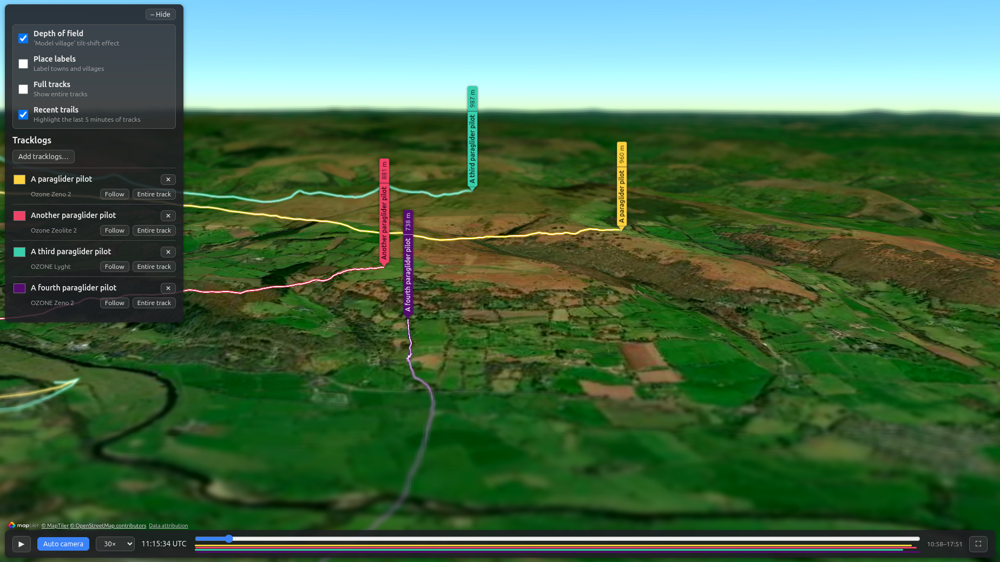

# Tracklog Viewer

View IGC, GPX, FIT and TCX tracklogs (paragliding flights, hike-and-fly, walks, rides) in 3D over
real terrain and satellite imagery, in your browser.



**Watch a highlights reel exported from the app:**

[](https://youtu.be/hU1SWIC6QYM)

## Quick start

You need **Python 3.10 or newer** ([python.org](https://www.python.org/downloads/); on
Windows, tick *"Add python.exe to PATH"* in the installer) and a free map key (step 3).

**1. Download the code**

```bash
git clone https://github.com/neilcharles/gps_tracklog_visualiser.git
cd gps_tracklog_visualiser
```

(Or use **Code → Download ZIP** on GitHub, unzip it, and open a terminal in that folder.)

**2. Install the dependencies** into a virtual environment

| Windows (PowerShell)                          | Linux / macOS                              |
|-----------------------------------------------|--------------------------------------------|
| `py -m venv .venv`                            | `python3 -m venv .venv`                    |
| `.venv\Scripts\Activate.ps1`                  | `source .venv/bin/activate`                |
| `python -m pip install -r requirements.txt`   | `python -m pip install -r requirements.txt` |

If PowerShell refuses to run `Activate.ps1`, run
`Set-ExecutionPolicy -Scope CurrentUser RemoteSigned` once, then try again.

**3. Add your map key**

Copy `.env.example` to `.env` (or skip this: the first run creates it for you), open it in a
text editor and fill in **one** of the keys:

```ini
MAPTILER_KEY=your-maptiler-key
```

See [Choosing a map key](#choosing-a-map-key) below for where to get one.

**4. Run it**

```bash
python run.py
```

Your browser opens at <http://localhost:8000>. Click **Add tracklogs…** to load files.
Press `Ctrl+C` in the terminal to stop.

Next time, you only need to activate the virtual environment (step 2, second line) and run
`python run.py`. Options: `--port 9000` to use another port, `--no-browser` to not open a tab.

## Choosing a map key

The key only controls where terrain and imagery come from. If both are set, MapTiler is used;
with neither, the map is flat.

| | **MapTiler** (default) | **Cesium ion** |
|---|---|---|
| Get a key | [cloud.maptiler.com/account/keys](https://cloud.maptiler.com/account/keys/) | [ion.cesium.com/tokens](https://ion.cesium.com/tokens) |
| `.env` setting | `MAPTILER_KEY=` | `CESIUM_ION_TOKEN=` |
| Quality | Slightly lower | Higher |
| Free usage | More generous: 100k tiles a month, then pauses until next month (no charges) | Lower allowance |
| Where to use it | Locally or deployed | **Locally only.** The free tier is for personal, non-commercial use, so don't use it on a public server |

If you restrict your MapTiler key to certain websites (*Allowed HTTP origins*), add
`localhost` to the list or the map will stay flat.

## Tracks from Strava

The viewer can't connect to Strava directly. Strava's API now needs a paid subscription just
to create the app that would sign in to your account. You can get your own tracks out of Strava
for free, though, and the viewer reads the files Strava gives you.

**One activity:** open the activity on strava.com (it has to be your own), click the **⋯**
menu and choose one of these:

- **Export Original**: the file exactly as your device or app uploaded it, usually FIT
  (Garmin, Wahoo, Coros, …), GPX or TCX. This is the best choice.
- **Export GPX**: Strava's own GPX version of the track. Use it if *Export Original* isn't
  offered, e.g. for activities recorded in the Strava app.

Then click **Add tracklogs…** and choose the downloaded file.

**All your activities at once:** in Strava go to **Settings → My Account → Download or Delete
Your Account → Request your archive**. Strava's wording here changes from time to time. Strava
emails you a link to a zip file. Unzip it (the viewer can't open the zip itself), and the
`activities` folder has one file per activity. Files ending in `.fit.gz`, `.gpx.gz` or
`.tcx.gz` load as they are, so there's no need to unzip those. The files are named by
number. To find a particular flight, look it up in `activities.csv` in the same zip, which
lists each file's date, name and type.

For paragliding, if you also have your vario's IGC file, use that instead. IGC has
barometric altitude, which is usually smoother and more accurate than a phone's or watch's GPS
altitude.

The same goes for Garmin Connect and most other apps: export the activity as FIT, GPX or TCX
(the format names vary) and add it with **Add tracklogs…**.

## Troubleshooting

- **"Dependencies aren't installed"**: the virtual environment isn't active, or step 2 was
  skipped. Activate it and run the `pip install` line again.
- **Flat map, no terrain**: no key was found. `run.py` says which map provider it's using when
  it starts. Check that the key is in `.env` (not `.env.example`), then restart.
- **Port already in use**: `python run.py --port 9000`.

## Development and deployment

```bash
python -m pip install -r requirements-dev.txt
pytest
```

To deploy to Google Cloud Run, see [DEPLOY.md](DEPLOY.md).
